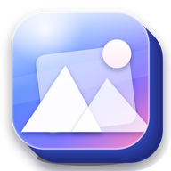
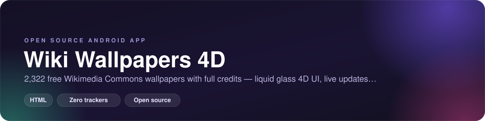
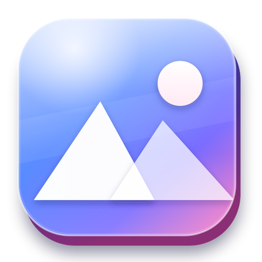
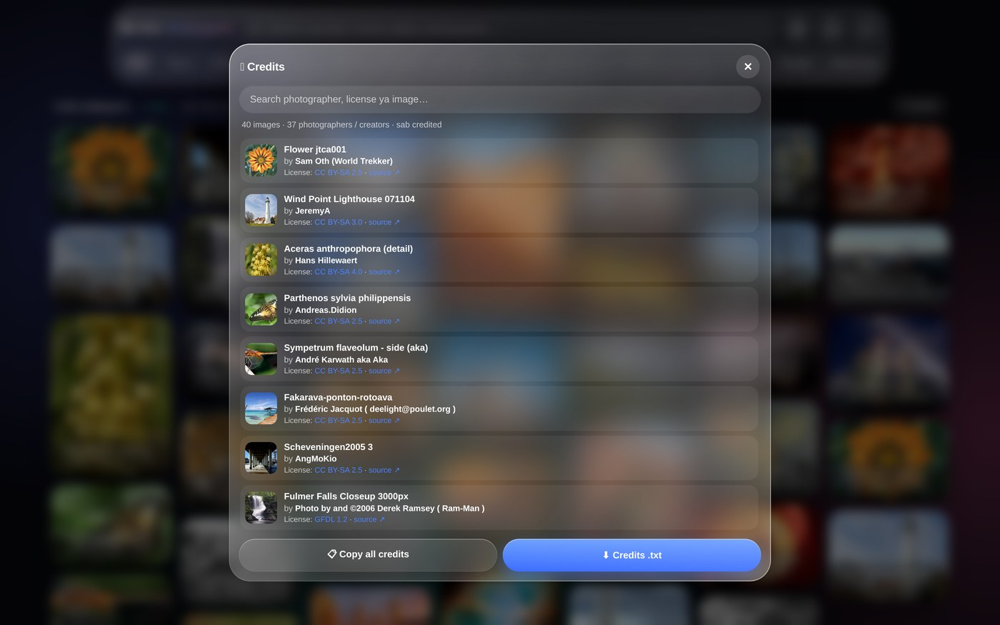
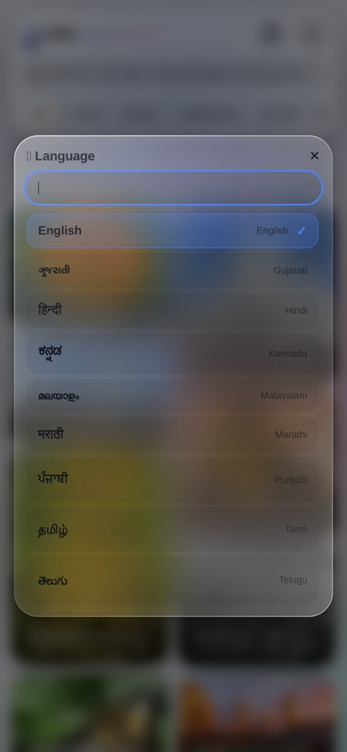

<div align="center">





<a href="https://github.com/technicalnihilist-lgtm/wiki-wallpaper-4d/stargazers"></a>&nbsp;<a href="https://github.com/technicalnihilist-lgtm/wiki-wallpaper-4d/network/members"></a>

<a href="https://github.com/technicalnihilist-lgtm/wiki-wallpaper-4d/releases/latest"></a>

<b>Support the work</b>

  

<sub>Donations aren't live yet — Paytm, UPI, PayPal and Buy&nbsp;Me&nbsp;a&nbsp;Coffee all show <b>coming soon</b>. Until then, a ⭐ star is the best support.</sub>

<a href="https://github.com/technicalnihilist-lgtm/wiki-wallpaper-4d/releases/latest"></a>  <a href="https://github.com/technicalnihilist-lgtm/wiki-wallpaper-4d/releases"></a>

</div>

---

<div align="center">



## What it is

A single-file wallpaper app (one HTML file, no build step, no framework) that turns
[Wikimedia Commons](https://commons.wikimedia.org) — the free media library behind Wikipedia —
into a wallpaper feed. Every image carries its photographer, license and source page,
because most of Commons is CC BY / CC BY-SA and **attribution is required**.

The Android app is a thin WebView shell around the exact same HTML, so web and APK
always behave identically.

## Store listing

Ready-to-paste listing copy, icon URL and screenshot URLs for app stores: [`STORE.md`](STORE.md)

## Screenshots

| Mobile feed | Fullscreen viewer | Credits |
|---|---|---|
|  |  |  |

| Language picker | 4D depth settings | Light theme |
|---|---|---|
|  |  |  |

## Languages

Settings → **Language** opens a searchable A–Z picker:

| | | |
|---|---|---|
| English | ગુજરાતી · Gujarati | हिन्दी · Hindi |
| ಕನ್ನಡ · Kannada | മലയാളം · Malayalam | मराठी · Marathi |
| ਪੰਜਾਬੀ · Punjabi | தமிழ் · Tamil | తెలుగు · Telugu |

Switching a language translates **every piece of UI text** — search placeholder, all 61
category chips, the status line, every toast, the image window, the credits sheet, the
whole settings panel and the fullscreen viewer — while **the wallpapers stay exactly the
same**: same photos, same titles, same photographers, same order. The choice is stored in
`localStorage` and restored on the next launch.

## Features

**4D glass UI**
Liquid-glass panels with real refraction (`feDisplacementMap`), a 3D tilt + glare on every
card, parallax backdrop, and optional gyroscope depth on phones. Every knob — blur,
transparency, saturation, corner radius, shine, tilt depth, animation curve and speed —
is live-tweakable from the settings popover and saved to `localStorage`.

**4D app icon**
The launcher icon is a real extruded tile — 26 stacked layers forming the side walls, a
glossy gradient face, a floating photo card behind the glyph and a ground shadow. Inside
the app the same icon tilts in 3D with your pointer (or the gyroscope) with a moving
specular highlight.

**2,322 wallpapers, instantly**
The whole curated library is embedded in the HTML, so the feed opens with zero network
and zero layout shift. 61 categories, mixed portrait/landscape masonry, lazy loading,
infinite scroll — with a throttled scroll listener and an explicit
**“N more wallpapers ↓”** button so the feed can never silently stall.

**Live from Commons**
- 🔄 **Pull down to refresh** — newest featured pictures are fetched and prepended with a `NEW` badge
- 🆕 **"New" chip** — the latest uploads from `Category:Featured pictures on Wikimedia Commons`, newest first
- ⏱️ **Auto-update** — checks every 2.5 minutes and offers a bottom snackbar with the new count
- 🌐 **Live search merged in** — any keyword also queries Commons directly
- ● **Live / ○ Offline** indicator, plus a full offline fallback on the embedded library
- Requests are throttled with exponential back-off and a 429 cool-down, so rapid category
  switching never gets rate-limited

**Fullscreen**
Edge-to-edge viewer with `Fit` / `Fill`, `‹ ›` arrows, `←` `→` keys, swipe navigation,
a credit strip that stays visible, and `Esc` to exit. The whole app also has an
`F` / header-button fullscreen mode.

**Credits, everywhere**
- `© Photographer · License` on every card
- Copy-ready credit line + license + source link in each image's window
- A searchable credits sheet (by photographer, license or title) with **Copy all** and **Credits .txt**
- [`CREDITS.md`](CREDITS.md) — all 2,322 images, one row each

**Made for phones**
A throttled image loader — three downloads at a time, 140 ms apart, with exponential
back-off and a global cool-down when the Wikimedia CDN starts returning `429 Too Many
Requests`. Without it, switching categories quickly got a screenful of broken thumbnails.
Plus `preconnect` to the CDN and a **Performance mode** that lightens blur and effects on
low-RAM devices. Text selection, long-press callouts and the context menu are disabled everywhere
except inputs and links — so holding a card never opens a copy popup.

## Run it

**Web** — open [`index.html`](index.html) in any modern browser. That's it.

**Android** — download `wiki-wallpapers-4d.apk` from the [latest release](../../releases/latest)
and install it (you'll need to allow "install unknown apps" for your browser/file manager).

| | |
|---|---|
| Package | `net.wikiwallpapers.app` |
| Version | 4.8.0 (versionCode 12) |
| Min / Target SDK | 24 (Android 7) / 34 |
| Size | ~525 KB |
| Permissions | Internet, network state, set wallpaper |

## Build the APK

The APK is built **without Gradle** — just `aapt2` + `javac` + `d8` + `apksigner`,
so it builds in seconds and needs no dependency downloads.

```bash
## Daily maintenance

This project is optimised and bug-fixed **every day** by an automated agent run
(`03:30 IST`). The rules for that job are strict:

- **No UI changes** — no layout, colour, wording, feature or interaction changes
- Only correctness, stability and speed
- Every change is measured or reproduced before it ships (live-CDN harness, Long Tasks API, 429 counters)
- Every change is recorded in [`CHANGELOG.md`](CHANGELOG.md) and shipped as a new signed APK

`tools/setup-build.sh` provisions the JDK + Android SDK pieces the Gradle-free build needs.

## Project layout

```
index.html                  the whole app (UI + data + i18n + logic, single file)
screenshots/                README images
CREDITS.md                  per-image attribution for all 2,322 wallpapers
android/
  AndroidManifest.xml
  src/net/wikiwallpapers/app/MainActivity.java   WebView shell + back-button handling
  res/                                            launcher icons, strings
  assets/index.html                               copy of the app
  build-apk.sh                                    Gradle-free build script
```

## How the data works

The embedded library stores, per image: `i` id, `t` title, `a` artist, `l` license,
`lu` license URL, `p` Commons file page, `th` thumbnail, `w`/`h` size, `d` description,
`c` category. Live results are fetched from the Commons API
(`action=query`, `prop=imageinfo`, `iiprop=url|size|mime|extmetadata`) and normalised into
the same shape, so the UI never cares where an image came from.

The interface strings live in one `I18N` table (131 keys × 9 languages) and are read
through a small `t()` helper, so adding a language means adding one dictionary.

## Credits & license

**Code:** [MIT](LICENSE).

**Images:** each wallpaper keeps its own license from Wikimedia Commons — CC BY-SA 4.0
(1,237), CC BY-SA 3.0 (410), Public domain (203), CC BY 4.0 (139), CC0 (71), and others.
Full attribution for every image is in [`CREDITS.md`](CREDITS.md). Images are loaded from
Wikimedia's servers, not re-hosted. If you repost a wallpaper, keep the credit line.

Built with ❤️ for Wikipedia's photographers.

---

## 🌍 Languages

<sub>Donations are <b>coming soon</b> in every language below — nothing to pay today, nothing to click.</sub>

<div align="center">

<sub><b>हिन्दी · বাংলা · मराठी · తెలుగు · தமிழ் · ગુજરાતી · ಕನ್ನಡ · മലയാളം · ਪੰਜਾਬੀ · ଓଡ଼ିଆ · অসমীয়া · اردو</b></sub>

</div>

<details>
<summary><b>🌍 Open the same message in 53 languages</b></summary>

**🇮🇳 Indian languages**

- **हिन्दी** (Hindi) — ☕ जल्द ही आ रहा है। · ⭐ अगर आपको यह ऐप और हमारा काम पसंद है, तो कृपया रिपॉजिटरी को स्टार दें और हमें फॉलो करें।
- **বাংলা** (Bengali) — ☕ খুব শিগগিরই আসছে। · ⭐ যদি আপনার এই অ্যাপ এবং আমাদের কাজ ভালো লাগে, তবে অনুগ্রহ করে রিপোজিটরিটিকে একটি স্টার দিন এবং আমাদের ফলো করুন।
- **मराठी** (Marathi) — ☕ लवकरच येत आहे. · ⭐ जर तुम्हाला हे ॲप आणि आमचं काम आवडलं असेल, तर कृपया रिपॉझिटरीला स्टार द्या आणि आम्हाला फॉलो करा.
- **తెలుగు** (Telugu) — ☕ త్వరలో రాబోతోంది. · ⭐ మీకు ఈ యాప్, మా పని నచ్చితే, దయచేసి రిపోజిటరీకి ఒక స్టార్ ఇచ్చి మమ్మల్ని ఫాలో అవ్వండి.
- **தமிழ்** (Tamil) — ☕ விரைவில் வருகிறது. · ⭐ உங்களுக்கு இந்த ஆப்பும் எங்க வேலையும் பிடிச்சிருந்தா, தயவுசெஞ்சு இந்த ரெபாசிட்டரிக்கு ஒரு ஸ்டார்…
- **ગુજરાતી** (Gujarati) — ☕ ટૂંક સમયમાં આવી રહ્યું છે. · ⭐ જો તમને આ એપ અને અમારું કામ ગમતું હોય, તો પ્લીઝ રિપોઝિટરીને સ્ટાર આપો અને અમને ફોલો કરો.
- **ಕನ್ನಡ** (Kannada) — ☕ ಶೀಘ್ರದಲ್ಲೇ ಬರುತ್ತಿದೆ. · ⭐ ನಿಮಗೆ ಈ ಆ್ಯಪ್ ಮತ್ತು ನಮ್ಮ ಕೆಲಸ ಇಷ್ಟವಾದರೆ, ದಯವಿಟ್ಟು ರೆಪೊಸಿಟರಿಗೆ ಸ್ಟಾರ್ ಕೊಡಿ ಮತ್ತು ನಮ್ಮನ್ನು ಫಾಲೋ ಮಾಡಿ.
- **മലയാളം** (Malayalam) — ☕ ഉടൻ വരുന്നു. · ⭐ നിങ്ങൾക്ക് ഈ ആപ്പും ഞങ്ങളുടെ പ്രവർത്തനവും ഇഷ്ടപ്പെട്ടെങ്കിൽ, ദയവായി റെപ്പോസിറ്ററിക്ക് ഒരു സ്റ്റാർ…
- **ਪੰਜਾਬੀ** (Punjabi) — ☕ ਜਲਦੀ ਆ ਰਿਹਾ ਹੈ। · ⭐ ਜੇ ਤੁਹਾਨੂੰ ਇਹ ਐਪ ਅਤੇ ਸਾਡਾ ਕੰਮ ਪਸੰਦ ਹੈ, ਤਾਂ ਕਿਰਪਾ ਕਰਕੇ ਰਿਪੋਜ਼ਟਰੀ ਨੂੰ ਸਟਾਰ ਦਿਓ ਅਤੇ ਸਾਨੂੰ ਫਾਲੋ ਕਰੋ।
- **ଓଡ଼ିଆ** (Odia) — ☕ ଖୁବ୍ ଶୀଘ୍ର ଆସୁଛି। · ⭐ ଯଦି ଆପଣଙ୍କୁ ଏହି ଆପ୍ ଏବଂ ଆମର କାମ ଭଲ ଲାଗୁଛି, ତେବେ ଦୟାକରି ରିପୋଜିଟୋରୀକୁ ଗୋଟିଏ ଷ୍ଟାର୍ ଦିଅନ୍ତୁ ଏବଂ ଆମକୁ ଫଲୋ କରନ୍ତୁ।
- **অসমীয়া** (Assamese) — ☕ অতি সোনকালেই আহি আছে। · ⭐ যদি আপুনি এই এপটো আৰু আমাৰ কাম ভাল পায়, তেন্তে অনুগ্ৰহ কৰি ৰিপজিটৰীটোক এটা ষ্টাৰ দিয়ক আৰু আমাক ফ'ল' কৰক।
- **اردو** (Urdu) — ☕ جلد آرہا ہے۔ · ⭐ اگر آپ کو یہ ایپ اور ہمارا کام پسند آئے تو براہ کرم ریپازٹری کو سٹار دیں اور ہمیں فالو کریں۔
- **संस्कृतम्** (Sanskrit) — ☕ शीघ्रमेव आगच्छति।
- **मैथिली** (Maithili) — ☕ जल्दिये आबि रहल अछि।
- **कोंकणी** (Konkani) — ☕ रोखडेंच येता.
- **کٲشُر** (Kashmiri) — ☕ جَلدی یِوان چھُ۔
- **سنڌي** (Sindhi) — ☕ जल्द अची रह्यो आहे।
- **डोगरी** (Dogri) — ☕ जल्दी आ करदा ऐ।
- **ꯃꯤꯇꯩ ꯂꯣꯟ** (Manipuri) — ☕ ꯑꯊꯨꯕꯥ ꯃꯇꯝꯗꯥ ꯂꯥꯛꯀꯅꯤ꯫
- **बर’** (Bodo) — ☕ थाबैनो फैगोन।
- **ᱥᱟᱱᱛᱟᱲᱤ** (Santali) — ☕ ᱞᱚᱜᱚᱱ ᱦᱤᱡᱩᱜ ᱠᱟᱱᱟ᱾
- **नेपाली** (Nepali) — ☕ छिट्टै आउँदैछ। · ⭐ यदि तपाईंलाई यो एप र हाम्रो काम मन पर्‍यो भने, कृपया रिपोजिटरीलाई स्टार दिनुहोस् र हामीलाई फलो गर्नुहोस्।

**🌍 World languages**

- **العربية** (Arabic) — ☕ قريبًا. · ⭐ إذا أعجبك هذا التطبيق وعملنا، فيرجى منح المستودع نجمة ومتابعتنا.
- **简体中文** (Chinese (Simplified)) — ☕ 即将推出。
- **繁體中文** (Chinese (Traditional)) — ☕ 即將推出。
- **Čeština** (Czech) — ☕ Již brzy.
- **Dansk** (Danish) — ☕ Kommer snart.
- **Nederlands** (Dutch) — ☕ Binnenkort beschikbaar. · ⭐ Vind je deze app en ons werk leuk?
- **Filipino** (Filipino) — ☕ Malapit na.
- **Suomi** (Finnish) — ☕ Tulossa pian.
- **Français** (French) — ☕ Bientôt disponible. · ⭐ Si cette application et notre travail vous plaisent, mettez une étoile au dépôt et suivez-nous.
- **Deutsch** (German) — ☕ Bald verfügbar. · ⭐ Wenn dir diese App und unsere Arbeit gefallen, gib dem Repository einen Stern und folge uns.
- **Ελληνικά** (Greek) — ☕ Έρχεται σύντομα.
- **עברית** (Hebrew) — ☕ בקרוב.
- **Magyar** (Hungarian) — ☕ Hamarosan.
- **Bahasa Indonesia** (Indonesian) — ☕ Segera hadir. · ⭐ Jika kamu suka aplikasi ini dan karya kami, beri bintang pada repositori ini dan ikuti kami.
- **Italiano** (Italian) — ☕ In arrivo.
- **日本語** (Japanese) — ☕ 近日公開。 · ⭐ このアプリと私たちの仕事が気に入ったら、リポジトリにスターを付けてフォローしてください。
- **한국어** (Korean) — ☕ 곧 공개됩니다. · ⭐ 이 앱과 저희 작업이 마음에 드신다면 저장소에 스타를 눌러 주시고 팔로우해 주세요.
- **Bahasa Melayu** (Malay) — ☕ Akan datang.
- **Norsk** (Norwegian) — ☕ Kommer snart.
- **فارسی** (Persian) — ☕ به‌زودی.
- **Polski** (Polish) — ☕ Wkrótce. · ⭐ Jeśli podoba Ci się ta aplikacja i nasza praca, daj repozytorium gwiazdkę i obserwuj nas.
- **Português** (Portuguese) — ☕ Em breve.
- **Română** (Romanian) — ☕ În curând.
- **Русский** (Russian) — ☕ Скоро. · ⭐ Если вам нравится это приложение и наша работа, поставьте звёздочку репозиторию и подпишитесь на нас.
- **Español** (Spanish) — ☕ Muy pronto. · ⭐ Si te gusta esta app y nuestro trabajo, dale una estrella al repositorio y síguenos.
- **Kiswahili** (Swahili) — ☕ Inakuja hivi karibuni.
- **Svenska** (Swedish) — ☕ Kommer snart.
- **ไทย** (Thai) — ☕ เร็ว ๆ นี้
- **Türkçe** (Turkish) — ☕ Çok yakında.
- **Українська** (Ukrainian) — ☕ Незабаром.
- **Tiếng Việt** (Vietnamese) — ☕ Sắp ra mắt. · ⭐ Nếu bạn thích ứng dụng này và công việc của chúng tôi, hãy tặng kho lưu trữ một ngôi sao và theo…

</details>

