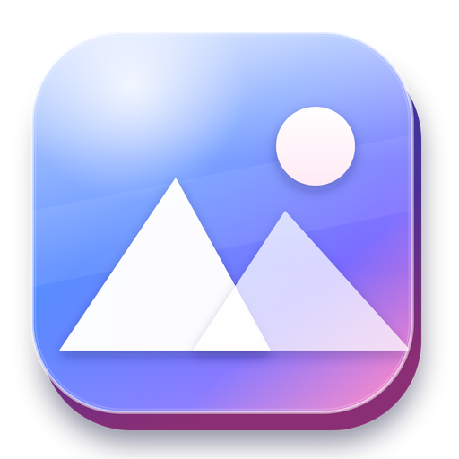
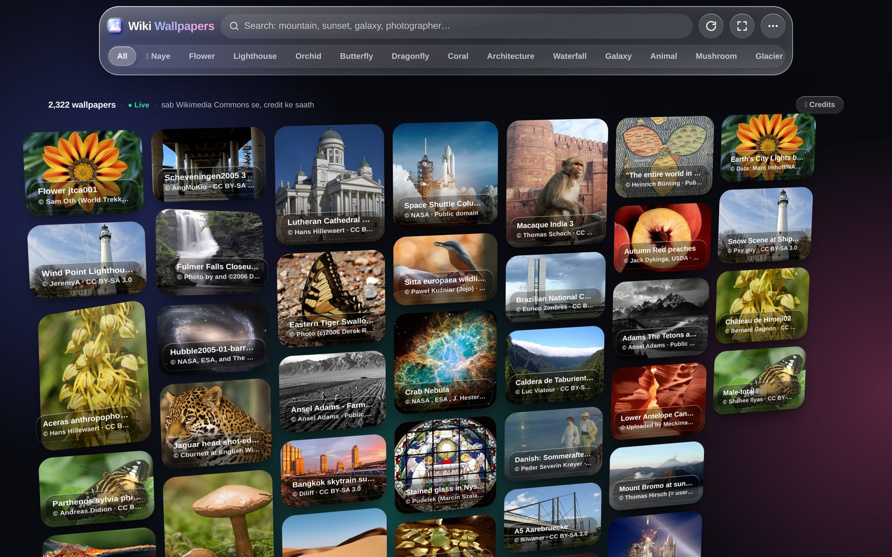
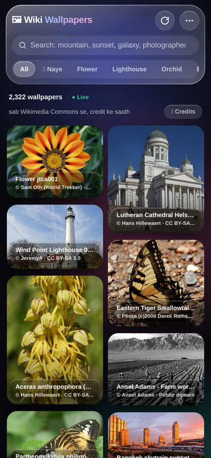
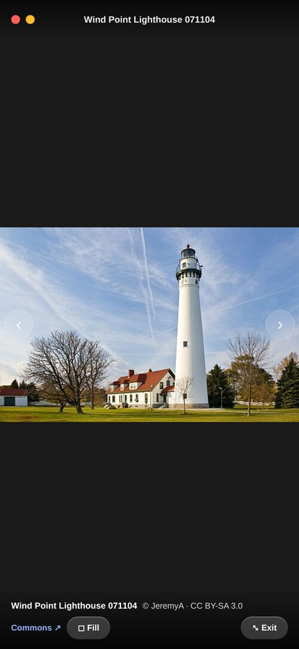
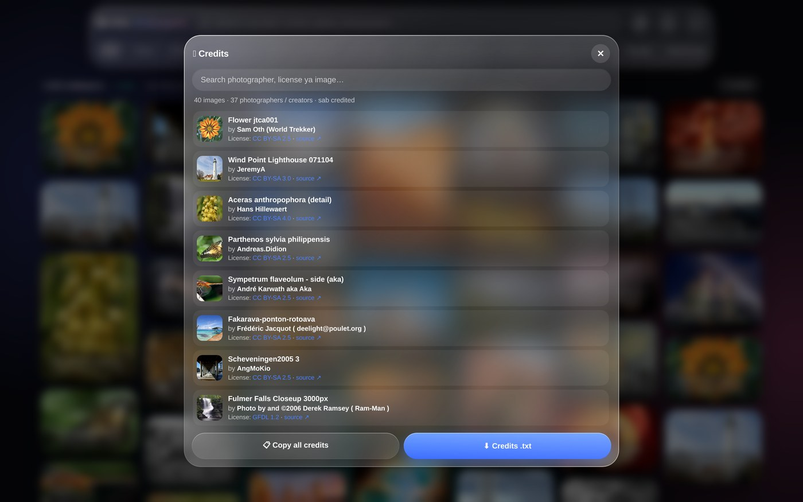
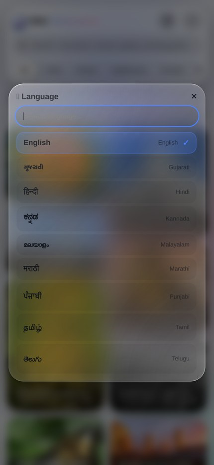
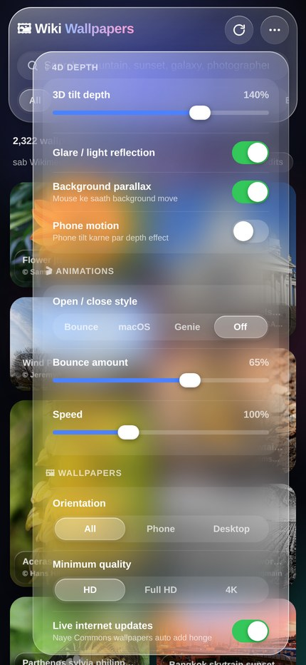
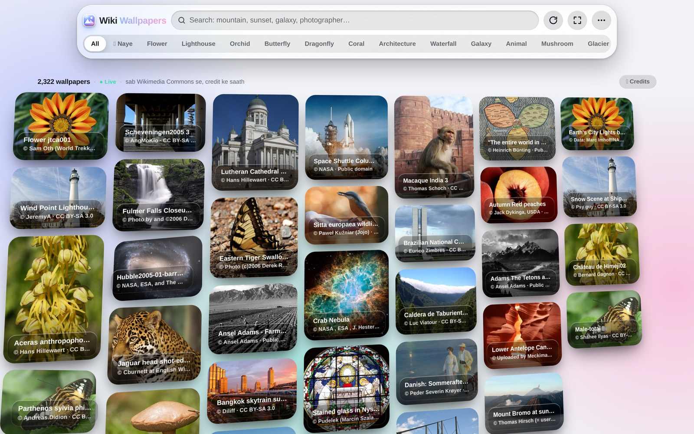

<div align="center">



# Wiki Wallpapers 4D

**2,322 free wallpapers from Wikimedia Commons — liquid-glass UI, 4D depth, live updates, full credits, and a 9-language interface.**

[](#-run-it)
[](../../releases/latest)
[](#-languages)
[](LICENSE)
[](CREDITS.md)



</div>

---

## What it is

A single-file wallpaper app (one HTML file, no build step, no framework) that turns
[Wikimedia Commons](https://commons.wikimedia.org) — the free media library behind Wikipedia —
into a wallpaper feed. Every image carries its photographer, license and source page,
because most of Commons is CC BY / CC BY-SA and **attribution is required**.

The Android app is a thin WebView shell around the exact same HTML, so web and APK
always behave identically.

## Store listing

Ready-to-paste listing copy, icon URL and screenshot URLs for app stores: [`STORE.md`](STORE.md)

## Screenshots

| Mobile feed | Fullscreen viewer | Credits |
|---|---|---|
|  |  |  |

| Language picker | 4D depth settings | Light theme |
|---|---|---|
|  |  |  |

## Languages

Settings → **Language** opens a searchable A–Z picker:

| | | |
|---|---|---|
| English | ગુજરાતી · Gujarati | हिन्दी · Hindi |
| ಕನ್ನಡ · Kannada | മലയാളം · Malayalam | मराठी · Marathi |
| ਪੰਜਾਬੀ · Punjabi | தமிழ் · Tamil | తెలుగు · Telugu |

Switching a language translates **every piece of UI text** — search placeholder, all 61
category chips, the status line, every toast, the image window, the credits sheet, the
whole settings panel and the fullscreen viewer — while **the wallpapers stay exactly the
same**: same photos, same titles, same photographers, same order. The choice is stored in
`localStorage` and restored on the next launch.

## Features

**4D glass UI**
Liquid-glass panels with real refraction (`feDisplacementMap`), a 3D tilt + glare on every
card, parallax backdrop, and optional gyroscope depth on phones. Every knob — blur,
transparency, saturation, corner radius, shine, tilt depth, animation curve and speed —
is live-tweakable from the settings popover and saved to `localStorage`.

**4D app icon**
The launcher icon is a real extruded tile — 26 stacked layers forming the side walls, a
glossy gradient face, a floating photo card behind the glyph and a ground shadow. Inside
the app the same icon tilts in 3D with your pointer (or the gyroscope) with a moving
specular highlight.

**2,322 wallpapers, instantly**
The whole curated library is embedded in the HTML, so the feed opens with zero network
and zero layout shift. 61 categories, mixed portrait/landscape masonry, lazy loading,
infinite scroll — with a throttled scroll listener and an explicit
**“N more wallpapers ↓”** button so the feed can never silently stall.

**Live from Commons**
- 🔄 **Pull down to refresh** — newest featured pictures are fetched and prepended with a `NEW` badge
- 🆕 **"New" chip** — the latest uploads from `Category:Featured pictures on Wikimedia Commons`, newest first
- ⏱️ **Auto-update** — checks every 2.5 minutes and offers a bottom snackbar with the new count
- 🌐 **Live search merged in** — any keyword also queries Commons directly
- ● **Live / ○ Offline** indicator, plus a full offline fallback on the embedded library
- Requests are throttled with exponential back-off and a 429 cool-down, so rapid category
  switching never gets rate-limited

**Fullscreen**
Edge-to-edge viewer with `Fit` / `Fill`, `‹ ›` arrows, `←` `→` keys, swipe navigation,
a credit strip that stays visible, and `Esc` to exit. The whole app also has an
`F` / header-button fullscreen mode.

**Credits, everywhere**
- `© Photographer · License` on every card
- Copy-ready credit line + license + source link in each image's window
- A searchable credits sheet (by photographer, license or title) with **Copy all** and **Credits .txt**
- [`CREDITS.md`](CREDITS.md) — all 2,322 images, one row each

**Made for phones**
A throttled image loader — three downloads at a time, 140 ms apart, with exponential
back-off and a global cool-down when the Wikimedia CDN starts returning `429 Too Many
Requests`. Without it, switching categories quickly got a screenful of broken thumbnails.
Plus `preconnect` to the CDN and a **Performance mode** that lightens blur and effects on
low-RAM devices. Text selection, long-press callouts and the context menu are disabled everywhere
except inputs and links — so holding a card never opens a copy popup.

## Run it

**Web** — open [`index.html`](index.html) in any modern browser. That's it.

**Android** — download `wiki-wallpapers-4d.apk` from the [latest release](../../releases/latest)
and install it (you'll need to allow "install unknown apps" for your browser/file manager).

| | |
|---|---|
| Package | `net.wikiwallpapers.app` |
| Version | 4.8.0 (versionCode 12) |
| Min / Target SDK | 24 (Android 7) / 34 |
| Size | ~525 KB |
| Permissions | Internet, network state, set wallpaper |

## Build the APK

The APK is built **without Gradle** — just `aapt2` + `javac` + `d8` + `apksigner`,
so it builds in seconds and needs no dependency downloads.

```bash
# needs JDK 17 and Android SDK build-tools 34 + platform 34
export ANDROID_SDK=/path/to/android-sdk
export JAVA_HOME=/path/to/jdk-17
cd android && ./build-apk.sh
# → android/build/wiki-wallpapers-4d.apk
```

`android/assets/index.html` is a copy of the root `index.html` — update both when you change the app.

The signing key is committed at `android/tools/keystore.jks`
(store & key password `wikiwallpapers`, alias `wikiwallpapers`) so that future builds
can be installed as an update over this one. Replace it with your own key for a real release.


## Daily maintenance

This project is optimised and bug-fixed **every day** by an automated agent run
(`03:30 IST`). The rules for that job are strict:

- **No UI changes** — no layout, colour, wording, feature or interaction changes
- Only correctness, stability and speed
- Every change is measured or reproduced before it ships (live-CDN harness, Long Tasks API, 429 counters)
- Every change is recorded in [`CHANGELOG.md`](CHANGELOG.md) and shipped as a new signed APK

`tools/setup-build.sh` provisions the JDK + Android SDK pieces the Gradle-free build needs.

## Project layout

```
index.html                  the whole app (UI + data + i18n + logic, single file)
screenshots/                README images
CREDITS.md                  per-image attribution for all 2,322 wallpapers
android/
  AndroidManifest.xml
  src/net/wikiwallpapers/app/MainActivity.java   WebView shell + back-button handling
  res/                                            launcher icons, strings
  assets/index.html                               copy of the app
  build-apk.sh                                    Gradle-free build script
```

## How the data works

The embedded library stores, per image: `i` id, `t` title, `a` artist, `l` license,
`lu` license URL, `p` Commons file page, `th` thumbnail, `w`/`h` size, `d` description,
`c` category. Live results are fetched from the Commons API
(`action=query`, `prop=imageinfo`, `iiprop=url|size|mime|extmetadata`) and normalised into
the same shape, so the UI never cares where an image came from.

The interface strings live in one `I18N` table (131 keys × 9 languages) and are read
through a small `t()` helper, so adding a language means adding one dictionary.

## Credits & license

**Code:** [MIT](LICENSE).

**Images:** each wallpaper keeps its own license from Wikimedia Commons — CC BY-SA 4.0
(1,237), CC BY-SA 3.0 (410), Public domain (203), CC BY 4.0 (139), CC0 (71), and others.
Full attribution for every image is in [`CREDITS.md`](CREDITS.md). Images are loaded from
Wikimedia's servers, not re-hosted. If you repost a wallpaper, keep the credit line.

Built with ❤️ for Wikipedia's photographers.
